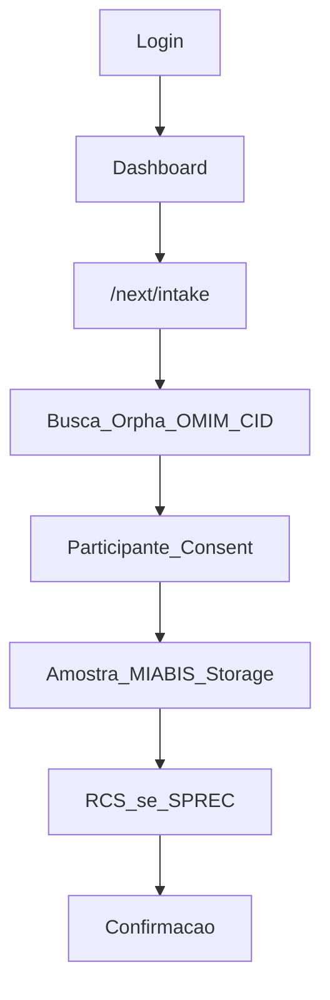

# Protótipo BF — Intake Wizard

**Telas conceituais (baixa fidelidade):**

1. Shell autenticado com nav destacando “Novo atendimento / Intake”.  
2. Painel de terminologia (Orpha → vínculos).  
3. Formulário participante + vínculo de TCLE.  
4. Formulário amostra (tipo/origem/protocolo) + posição.  
5. Resumo RCS (escopo: pré-analítico, não validade clínica).
